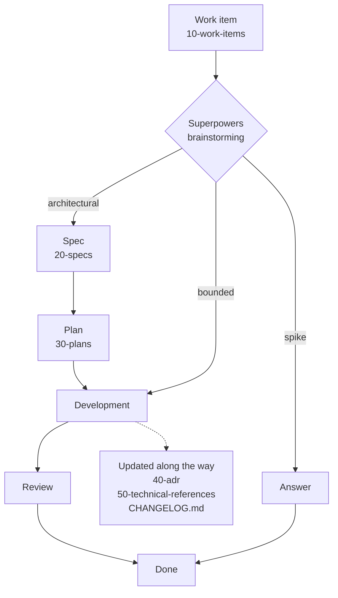

# Agent Memory Powers

[](LICENSE)

> **Your agent forgets. Your repo doesn't.**

Agent Memory Powers is a drop-in documentation structure that gives AI coding agents a **durable, written memory of your project**. Every step of the work — request, specification, plan, decision — leaves a Markdown document in a predictable place, with a clear owner and a clear lifespan. Each new agent session starts from what the project already knows instead of starting from scratch.

It works with coding agents that support `AGENTS.md` and [Agent Skills](https://agentskills.io) — Claude Code, OpenAI Codex, GitHub Copilot, Cursor, Gemini CLI, OpenCode… — and is built to pair with [Superpowers](https://github.com/obra/superpowers).

---

## Why

An AI coding agent starts every session with an empty head. Whatever was explained, decided or discovered in the previous session is gone unless it was written down — and when it *is* written down, it usually ends up scattered, stale, or contradicting the code.

Agent Memory Powers takes the opposite approach to memory engines and vector stores: **the memory is plain Markdown, in the repository**.

- Versioned with the code, reviewed like the code.
- Readable by humans and agents alike — no database, no server, no lock-in.
- Organized so that the agent always knows **where to look, where to write, and what it may not touch**.

## Key ideas

1. **A place for everything.** Numbered folders, each holding one kind of knowledge with its own lifecycle. The numbers follow the workflow, so the folders sort in the order work flows through them.
2. **Clear ownership.** Every file and folder states who writes it: you, the agent, or Superpowers. The agent never rewrites the body of your work items, never touches your `TODO.md`, and does not even read your drafts.
3. **A workflow that writes as it goes.** Work item → brainstorming → spec → plan → code. Decisions become ADRs, technical references stay in sync with the code, and the changelog records each change against its work item.
4. **The code wins.** Documents are memory, not truth. `AGENTS.md` tells the agent explicitly that the source code is the only reliable source of truth.

## How it works



1. **You write a request.** `/create-work-item <title>` creates a numbered work item with its front matter; you write the body. Or import an existing Jira issue with `/create-work-item-from-jira <key>`.
2. **Superpowers brainstorms it with you** and classifies it in the work item's front matter; the agent then sets the work item to `in-progress`:
   - `spike` — a question whose output is an answer, not code: once answered, the work item is `done`;
   - `bounded` — a well-scoped change in existing code: development can start right away;
   - `architectural` — a new project, subsystem or architectural change: it goes through a spec and a plan.
3. **Spec, then plan.** For architectural work, Superpowers writes a specification in `docs/20-specs` (*what must be true*). Once you approve it, it writes an execution plan in `docs/30-plans` (*how to get there*).
4. **Development**, once you approve the plan, under five rules spelled out in `AGENTS.md`:
   - **Sequential only** — one task at a time, no parallel runs;
   - **Clean context** — each sub-agent gets only the context it needs, with the specs;
   - **Adaptive effort** — model power and reasoning depth matched to the task;
   - **Strict review** — every delivery checked, rejected if specs or edge cases fail, fixed before the next step;
   - **Compact memory** — validated output summarized into the main context, intermediate logs dropped.
5. **Memory is updated along the way.** The agent proposes an ADR as soon as a decision is adopted (you confirm), keeps the relevant technical reference up to date, and logs the change in `CHANGELOG.md`. The work item's `status` follows the work: `new` → `in-progress` (once classified) → `review` → `done`.

## Repository layout

```
.
├── AGENTS.md                      # the agent's operating manual
├── CLAUDE.md                      # one line, "@AGENTS.md", for Claude Code
├── ARCHITECTURE.md                # software architecture only, self-contained
├── CODEMAP.md                     # map of the code, built from the sources only
├── CHANGELOG.md                   # concise log of software changes
├── TODO.md                        # yours; the agent never touches it
├── README.md, LICENSE             # this template's own; not copied into your project
├── .gitignore                     # rules to merge into your project's .gitignore
├── docs/
│   ├── 00-knowledge-base/         # durable domain knowledge, incl. 010-glossary.md
│   ├── 05-draft/                  # your drafts; the agent does not read them
│   ├── 07-studies/                # one-off studies, written on request
│   ├── 10-work-items/             # requests for changes or fixes
│   ├── 20-specs/                  # specifications written by Superpowers
│   ├── 30-plans/                  # execution plans written by Superpowers
│   ├── 40-adr/                    # Architecture Decision Records
│   ├── 50-technical-references/   # one technical topic per document
│   └── work-items-settings.json   # work item prefix and Jira label
└── .agents/skills/
    ├── create-work-item/
    └── create-work-item-from-jira/
```

Each `docs/` folder has its own `README.md`, which defines what the folder holds and serves as its index, maintained by the agent.

## The memory map

Each kind of document has an owner and a lifespan. This is what lets the agent trust — or distrust — what it reads.

| Where | What it holds | Written by | Lifespan |
|---|---|---|---|
| `00-knowledge-base/` | Domain invariants and vocabulary (`010-glossary.md`) | You | Durable |
| `05-draft/` | Drafts and preliminary analyses | You | Private — the agent does not read it |
| `07-studies/` | Analyses of the repository or of a general topic | The agent, at your request | Snapshot — true at the date written, never updated |
| `10-work-items/` | The raw request for a change or a fix | You (body) · the agent (front matter only) | Historical — kept as a record |
| `20-specs/` | What must be true once the work is done | Superpowers | Per work item |
| `30-plans/` | How to do the work, task by task | Superpowers | Per work item |
| `40-adr/` | A decision, its context, consequences and rejected alternatives | Proposed by the agent, confirmed by you | Immutable — superseded by a new ADR, never rewritten |
| `50-technical-references/` | One technical topic per document | Created by you — or by the agent once you accept its proposal — and maintained by the agent | Living — updated as soon as the code changes |
| `CODEMAP.md` | Map of the code | The agent | Living |
| `ARCHITECTURE.md` | Software architecture | The agent | Updated when an architectural boundary is crossed |
| `CHANGELOG.md` | Software changes, each referencing its work item when there is one | The agent | Timestamped, concise log |
| `TODO.md` | Your own to-do list | You | Off-limits to the agent |

## Work items

A work item is a Markdown file whose front matter carries its state:

```yaml
---
id: AMP-0001
title: "Fix login timeout on slow networks"
status: new
superpowers-class: 
tags: []
---
```

| `status` | Set by |
|---|---|
| `draft` | You |
| `new` | The creation skill |
| `deferred` | You |
| `in-progress` | The agent, once Superpowers has classified the work item |
| `review` | The agent, when Superpowers reaches code review |
| `done` | The agent, at the final commit — or, for a `spike`, once the answer has been given |
| `canceled` | You |

Two families of work items coexist:

- **Local work items**, created by `/create-work-item`, use the prefix set in `docs/work-items-settings.json` and the next free number — e.g. `AMP-0001-fix-login-timeout-on-slow-networks.md`.
- **Work items imported from Jira**, created by `/create-work-item-from-jira`, keep the Jira project key and pad the issue number to four digits — `PROJ-558` becomes `PROJ-0558-<slug>.md`. They carry two extra marks: the `Jira` tag and a `jira: PROJ-558` field holding the exact issue key.

The agent only ever edits a work item's front matter. The one exception is the Jira import, which writes the body at creation — and only then.

## Skills

The repository ships two [Agent Skills](https://agentskills.io), in `.agents/skills/`. The commands below use Claude Code's slash syntax; other agents invoke skills by name, with their own syntax.

### `/create-work-item <title>`

Creates one numbered work item and adds it to the folder index. It is deliberately defensive:

- it never overwrites, renumbers or edits an existing work item;
- it never falls back to a default prefix — an unreadable settings file stops it;
- it stops if work items with the prefix exist but cannot be parsed, instead of restarting at 1;
- it writes the front matter only: the body is yours.

### `/create-work-item-from-jira <key>`

Imports a Jira issue as a work item, then adds a label to the issue in Jira, so you can see which issues have been handed to the agent. The label is set by `jiraLabel` in `docs/work-items-settings.json` — `ai-agent` by default. The skill requires an Atlassian (Jira) MCP server configured in your agent.

- The issue's summary (with its parent epic), description and link are written to the work item; images are replaced by a mention pointing back to Jira.
- The label is checked before anything is read or written, added only once the local file exists, and the existing labels are preserved.
- All the exact work — key validation, padding, duplicate refusal, slug, YAML escaping — is done by `compose.js`, which is covered by tests:

```bash
node .agents/skills/create-work-item-from-jira/tests.js
```

If you installed the skills in `.claude/skills/`, run `node .claude/skills/create-work-item-from-jira/tests.js` instead.

## Requirements

- **A coding agent that supports `AGENTS.md` and Agent Skills** — such as [Claude Code](https://claude.com/claude-code), OpenAI Codex, GitHub Copilot, Cursor, Gemini CLI or OpenCode. Claude Code reads `CLAUDE.md`, which imports `AGENTS.md`.
- **[Superpowers](https://github.com/obra/superpowers)** — for brainstorming, specs, plans and development. Check its README for the agents it supports.
- **[Node.js](https://nodejs.org/)** — used by the skills.
- *Optional:* an **Atlassian (Jira) MCP server** configured in your agent, for the Jira import skill.
- *Optional:* **[Obsidian](https://obsidian.md/)** — the repository opens as a vault, which makes browsing and linking the documents pleasant. `.obsidian/` is git-ignored.

## Installation

Agent Memory Powers goes **into an existing project**: you add its files, then let the agent fill in what it can.

1. **Add the files to your project** — everything in this repository except `README.md` and `LICENSE`, which describe the template itself. If a file already exists in your project, keep yours:
   - an existing `AGENTS.md`: merge this template's sections into it;
   - an existing `CLAUDE.md`: add the line `@AGENTS.md` to it.
2. **Using Claude Code? Rename the `.agents/` folder to `.claude/`.** Claude Code only looks for skills in `.claude/skills/`. If your project already has a `.claude/` folder, move `.agents/skills/` into it instead. Other agents — Codex, GitHub Copilot, Cursor, Gemini CLI, OpenCode… — read `.agents/skills/` as is.
3. **Name your project.** In `AGENTS.md`, replace **TO BE COMPLETED** on the first line with your project's name and a one-line description.
4. **Configure the work items.** In `docs/work-items-settings.json`, set `prefix` to your project's ticket code. If you use the Jira import, `jiraLabel` is the label added to imported issues — `ai-agent` by default, without spaces.
5. **Merge the `.gitignore` rules** into your project's `.gitignore`: they keep the skills versioned and Obsidian's local files out of git. If your `.gitignore` already has a `.claude/` line, replace it with these rules.
6. **Let the agent bootstrap the memory.** In your agent, run these prompts:
   - *Generate a code map of the project in CODEMAP.md*
   - *Generate ARCHITECTURE.md following the guidelines in AGENTS.md*
   - *Analyze the project and generate a glossary of domain and product terms in docs/00-knowledge-base/010-glossary.md, following the format described at the top of the file*
7. **Review the glossary yourself.** Remove what is not relevant and add the entries that are missing: it is the vocabulary the agent will reason with.
8. **Install Superpowers.** In Claude Code, adding its marketplace keeps you on the latest versions:

   ```
   /plugin marketplace add obra/superpowers-marketplace
   ```

   ```
   /plugin install superpowers@superpowers-marketplace
   ```

   For other agents and installation options, see the [Superpowers README](https://github.com/obra/superpowers).

## A day with Agent Memory Powers

1. `/create-work-item Fix login timeout on slow networks` creates `docs/10-work-items/AMP-0001-fix-login-timeout-on-slow-networks.md`. You describe the problem in its body.
2. You ask your agent to brainstorm work item `AMP-0001` with Superpowers. It reads the work item, asks its questions, and classifies it — say, `architectural`. The agent sets the work item to `in-progress`.
3. Superpowers writes `docs/20-specs/YYMMDD-AMP-0001-login-timeout.md`. You review and approve it.
4. Superpowers writes the execution plan in `docs/30-plans/`. You approve it, and development starts, one task at a time, each reviewed before the next.
5. Along the way, the agent proposes an ADR when you settle on a retry strategy, updates the networking technical reference, and logs the change in `CHANGELOG.md` against `AMP-0001`.
6. At the final commit, the work item is `done`. Next week, a fresh session finds the request, the spec, the plan, the decision and the up-to-date reference exactly where it expects them.

## Credits

Agent Memory Powers is an independent project, designed to pair with [Superpowers](https://github.com/obra/superpowers) by Jesse Vincent and Prime Radiant. It is not affiliated with Superpowers or its authors.

## License

[MIT](LICENSE)
